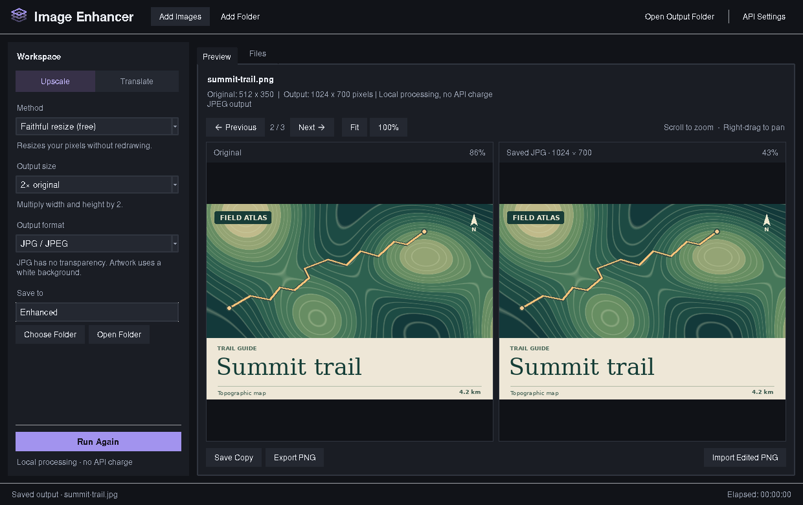

# Image Enhancer

Image Enhancer makes it easy to upscale images, translate text, and convert files between formats. Use OpenAI’s API for AI-assisted editing and translation, or resize and convert images locally. Work on a single image or process a batch at once.

### Supported formats

| Format                 | Import | Export |
| ---------------------- | ------ | ------ |
| PNG (`.png`)           | ✅     | ✅     |
| JPEG (`.jpg`, `.jpeg`) | ✅     | ✅     |
| DDS (`.dds`)           | ✅     | ✅     |
| TGA (`.tga`)           | ✅     | ✅     |

## Get started

Install **64-bit Python 3.11–3.14** with Tkinter, extract the repository to a writable folder and open the launcher.

| Windows | macOS | Linux |
| --- | --- | --- |
| Double-click `run.cmd` | Open `Run.command` | Run `sh ./run.sh` |

The first launch installs dependencies into a local virtual environment. On Debian or Ubuntu, install `python3-tk` and `python3-venv` if needed. If you manage your own environment, run `python -m pip install .`, then `image-enhancer`.

## First folder

1. Choose **Use Local Mode** and **Add Folder**. **Neural artwork** works offline and suits illustrated buttons and icons.
2. Choose the size and **Output format**. **Retain original** preserves each supported encoding. Select **JPG / JPEG**, **PNG**, **TGA** or **DDS** to export the folder in one format.
3. Choose a destination and select **Run Queue**. Open **Preview** and press **← / →** to compare each original with its saved output.

Press **A** on any queued image to annotate it. **F1** or **Shortcuts** opens the [keyboard guide](docs/usage.md#keyboard-shortcuts).

OpenAI enhancement, translation and optional per-file instructions use your own key. The app shows the paid request count before uploading.

[User guide](docs/usage.md) · [Format support](docs/formats.md) · [Contributing](CONTRIBUTING.md) · [Changelog](CHANGELOG.md)

Image Enhancer is [MIT licensed](LICENSE). The bundled Anime4K model by **bloc97** has its own [MIT notice](enhancer/models/Anime4K-LICENSE.txt).
