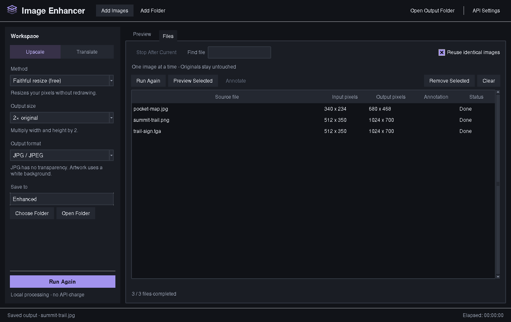
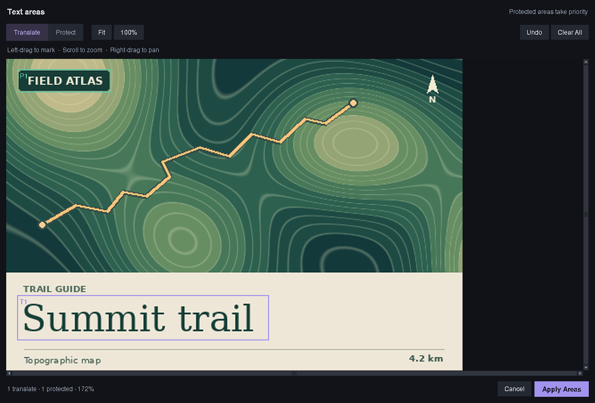

# User guide

## Choose a method

| Method | When to use it |
| --- | --- |
| Neural artwork | Reconstruct edges and transparency on illustrated icons, buttons and lettering. Runs locally on the CPU. |
| Faithful resize | Smoothly resize photos, soft artwork or channel textures without redrawing them. |
| Pixel art | Preserve hard pixel boundaries with nearest-neighbor scaling. |
| OpenAI enhancement | Restore or redraw details using an API key. **Detail recovery** supplies a local neural guide for enlargement. |
| Translate text | Change the language of lettering. Choose the source and target languages, then use **Mark Areas** to select or protect parts of the image. |

Use **API Settings** to enter a key or adjust rendering quality. The key stays in memory. The confirmation shows the number of paid edits before any upload.

## Size and format

**2×** through **8×** multiply both dimensions of each source. For example, 35 × 35 at 8× produces 280 × 280. **Custom scale factor** accepts decimals. **2K**, **4K** and **Custom longest edge** fit the longer side and keep proportions. Already-large unannotated sources keep their size.

Choose **Original size** and a local method to convert formats without enlarging or paying for an edit. **Retain original** keeps each source extension and its supported encoding. An explicit format uses its corresponding extension, including `.jpg` for JPEG. JPG artwork uses a white background where the source is transparent. Choose PNG, TGA or DDS to keep transparency. [Encoding details](formats.md)

## Folder runs and labels

**Add Folder** includes supported files in subfolders. **Run Queue** processes pending files one at a time. **Reuse identical images** lets matching pixels and instructions share work. Each filename gets an output in the chosen folder. Existing files and name collisions receive numbered copies such as `icon (2).jpg`.

To correct a hard-to-read button, select it in **Files** or browse to it in **Preview**. Press **A** and type the intended label, such as `Menü`, in **Exact text**. Drag an optional box around the lettering, leaving room for its accents. The app uses locally upscaled artwork outside the box. Choose **Remember for this file** to reuse the correction in later sessions.

With a local method selected, only annotated rows use OpenAI. Changing a finished row’s annotation queues that file again. **Run Again** repeats the entire queue. **Stop After Current** finishes the active file before stopping.

## Inspect and save

Open **Preview** and press **← / →** to move through the files in queue order. The counter shows your position. Completed rows show the saved file, including JPEG compression and palette changes. Pending rows show the source.

The mouse wheel zooms around the pointer. Right-drag pans, **Fit** frames the whole image and **100%** shows it at pixel size. **Save Copy** uses the selected output format. **Export PNG** writes the current working pixels. When you revisit an earlier file, those pixels come from its saved output. **Open Output Folder** opens the destination.

## Keyboard shortcuts

Use **Ctrl** on Windows and Linux, or **Cmd** on macOS. Open this reference in the app with **F1** or **Shortcuts**.

| Where | Keys | Action |
| --- | --- | --- |
| Workspace | Ctrl+O / Ctrl+Shift+O | Add images / add a folder |
| Workspace | Ctrl+F | Find a filename. Enter cycles through matches and F2 annotates the match. |
| Files | ↑ / ↓, then Enter | Select a row and open its preview |
| Files or Preview | A or F2 | Annotate the selected or displayed image in Upscale mode |
| Preview | ← / → | Browse the previous or next file. Alt+← / Alt+→ also work. |
| Preview | 0 / 1 | Fit both images / view them at 100% |
| Preview | Ctrl+S / Esc | Save a copy of the result / return to Files |
| Image editors | Ctrl+Enter / Esc | Save or apply changes / cancel |
| Mark Areas | Ctrl+Z | Undo the last box |

For a folder review, open the first preview with **Enter**. Use **→** to skip images and **A** when a label needs correction. Type the label, press **Ctrl+Enter**, then keep browsing. In **Exact text**, the arrows move the cursor and plain **Enter** adds a line.

## Translate selected text

In **Mark Areas**, drag a **Translate** rectangle around each label and its effects. Use **Protect** for nearby artwork that must stay intact. Protection wins on overlaps. **Wording** accepts one `Original => Translation` pair per line. Choose **All text (batch compatible)** for a folder run.

## Recovery

If export fails after a paid edit, open **API Settings → Open Recovery Folder** for the saved canvas or finished PNG. **Import Edited PNG** accepts an image at the planned working dimensions. It can then be saved in the selected format. Successful exports clear their intermediates unless you enable **Keep intermediate PNGs**. The app remembers the output folder between sessions.
